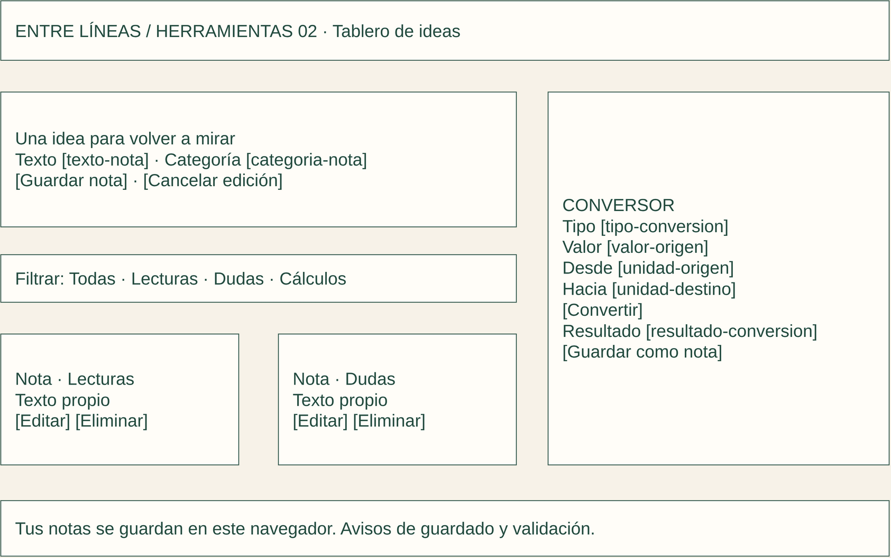
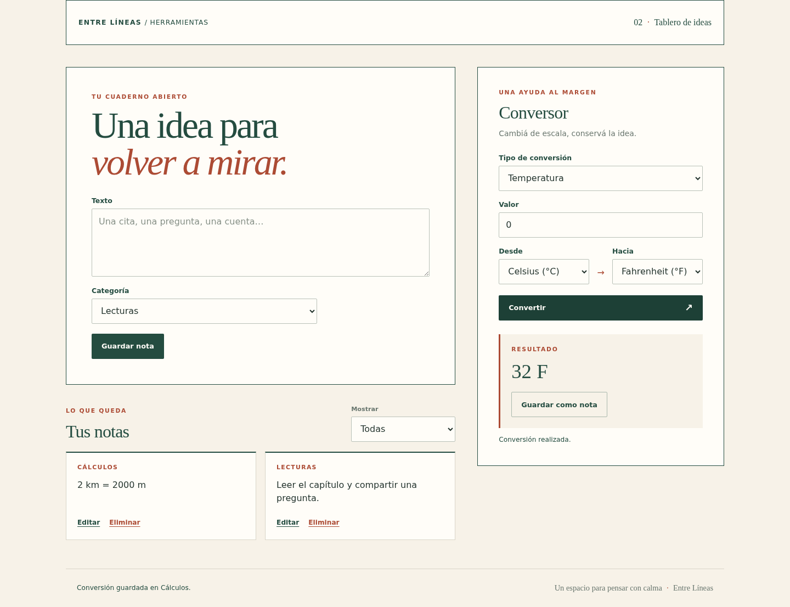
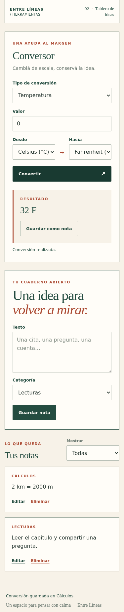

# Tablero de ideas · Entre Líneas

## 🧩 Datos generales

| Campo | Detalle |
| --- | --- |
| Integrante 1 | Sara Cohen |
| Integrante 2 | No corresponde: trabajo individual |
| Modelos de IA utilizados | ChatGPT; GPT-6 Luna (implementación y revisión) |
| Tecnologías del proyecto | HTML5, CSS3, JavaScript, Markdown, Visual Studio Code y GitHub |
| Link del repositorio | https://github.com/2023saracohen-yeshurun/pizarron-de-estudio |

---

## 📄 Sketch



Boceto conservado como referencia de distribución: cabecera a todo lo ancho, formulario y tarjetas de notas en la columna izquierda, conversor en la derecha y avisos al pie. En pantallas angostas, los paneles pasan a una columna.

## Planeamiento y decisiones

- Dirección editorial con crema `#f7f2e8`, verde pino `#244c40` y terracota `#ac4b34`; títulos Georgia y controles sans serif del sistema.
- Una página adaptable, con formulario para notas y conversor en paralelo en escritorio. En móvil, el conversor precede a las notas.
- Categorías: Lecturas, Dudas y Cálculos; el filtro suma Todas.
- Cada nota mantiene un identificador estable al editar. El texto ingresado se presenta con nodos y `textContent`, nunca como HTML.
- El conversor cubre longitud (m, km, cm), masa (kg, g) y temperatura (°C, °F, K). No admite entradas vacías, resultados no finitos ni temperaturas bajo cero absoluto.
- Una edición de valor o unidades invalida el resultado vigente. Solo ese resultado vigente se puede guardar como nota en Cálculos.
- Si el JSON guardado no se puede leer o no es una lista, se inicia con una lista vacía; si hay notas individuales dañadas, se conservan las válidas y se avisa. Si `localStorage` no está disponible o falla al escribir, la interfaz sigue operativa en memoria durante la sesión e informa que el cambio no quedó persistido.
- El almacenamiento pertenece a este navegador y perfil: no sincroniza entre dispositivos ni constituye una copia de seguridad.
- La consigna contiene una enumeración incompleta de funcionalidades. Este proyecto implementa notas, filtros, persistencia y conversor integrado; confirmar con la docente si exige alguna función adicional.

## 💬 Prompts utilizados

### Encargo inicial — fragmento funcional literal

> Crear/editar/eliminar/filtrar notas por Lecturas, Dudas, Cálculos, persistencia localStorage propia. Conversor longitud m km cm, masa kg g, temperatura C F K; validar finitos vacíos y cero absoluto. Guardar conversión como nota, invalidar resultado al cambiar entrada/unidades, no guardar viejo. Manejar localStorage corrupto/no disponible sin romper UI. Tests de conversiones y validaciones, identidad estable notas; UI responsive según boceto, CRUD seguro textContent.

## Pruebas ejecutadas

Las pruebas de lógica se escribieron antes de la implementación. Se observó primero el fallo por la ausencia de `script.js`; luego, una aserción ampliada para el overflow numérico falló antes de añadir el rechazo del resultado no finito.

Con Node.js v22.23.3 (`node`):

```bash
node --test tests/logic.test.js
node --check script.js
```

Resultado final: pruebas de lógica aprobadas; sintaxis de `script.js` validada. Se cubrieron conversiones de longitud y masa, conversiones de temperatura, entradas vacías y no finitas, unidades incompatibles, cero absoluto, overflow numérico, alta/edición/borrado/filtro de notas, estabilidad de identidad, rechazo de notas inválidas y datos JSON corruptos. Se ejecutaron también pruebas en Chrome: creación, edición, borrado, filtro, recarga, texto seguro, conversiones, invalidación del resultado y control del desbordamiento numérico. Se guardaron capturas de escritorio y móvil.

## Limitaciones

Las notas quedan en el almacenamiento local del navegador donde se crearon. Borrar los datos del sitio o usar otro navegador/dispositivo puede hacerlas inaccesibles. Sin almacenamiento disponible, los cambios solo se mantienen en memoria mientras la página está abierta. La omisión de una lista de funcionalidades requiere confirmación de la docente.

## Ejecución

Abrir `index.html` en un navegador moderno. No requiere compilación ni dependencias.


## Corrección de validaciones

Prueba en Chrome: convertir 1e308 km a cm arrojó una excepción sin mostrar el aviso en pantalla.

**Prompt de corrección utilizado:**

> Capturá los errores del conversor al desbordar el rango numérico, mostrá el mensaje en la interfaz e invalidá el resultado anterior. Si se elimina una nota mientras se la edita, cancelá esa edición. Alineá los identificadores de los campos con los nombres del boceto.

Se agregó manejo de la excepción en el formulario y se restablece la edición al borrar la nota activa.


## Evidencias de funcionamiento





[PDF de la ficha](evidencias/Preentrega4_Cohen_Sara.pdf)


## 🔄 Diferencias entre versiones

| Versión | Cambio | Motivo |
| --- | --- | --- |
| 1 | Notas persistentes y conversor integrado. | Dar una única pantalla de trabajo al club. |
| 2 | Aviso de desbordamiento, edición cancelada al borrar y nombres alineados al boceto. | Resolver casos observados durante la revisión. |


## Herramientas utilizadas

HTML, CSS, JavaScript, Visual Studio Code, GitHub, Chrome y archivos Markdown. Asistencia de IA: GPT-6 Luna en las tareas delegadas de implementación y revisión.

[Repositorio](https://github.com/2023saracohen-yeshurun/pizarron-de-estudio)

[Sitio del proyecto](https://2023saracohen-yeshurun.github.io/pizarron-de-estudio/)

## Estado del proyecto

- [x] Sketch previo al código.
- [x] Prompts y decisiones registrados.
- [x] Pruebas de lógica y navegador realizadas.
- [x] Archivos publicados en el repositorio público.
